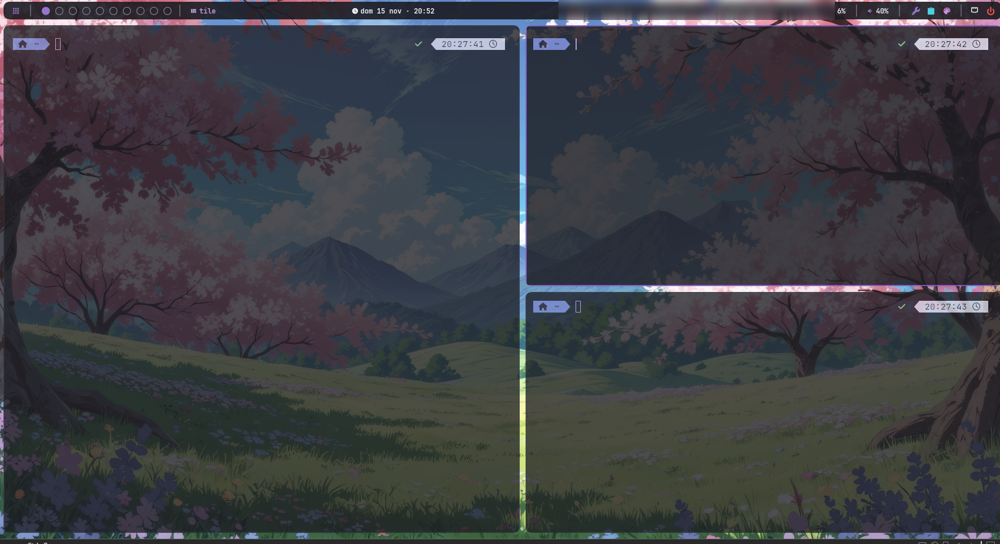
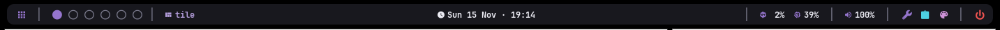
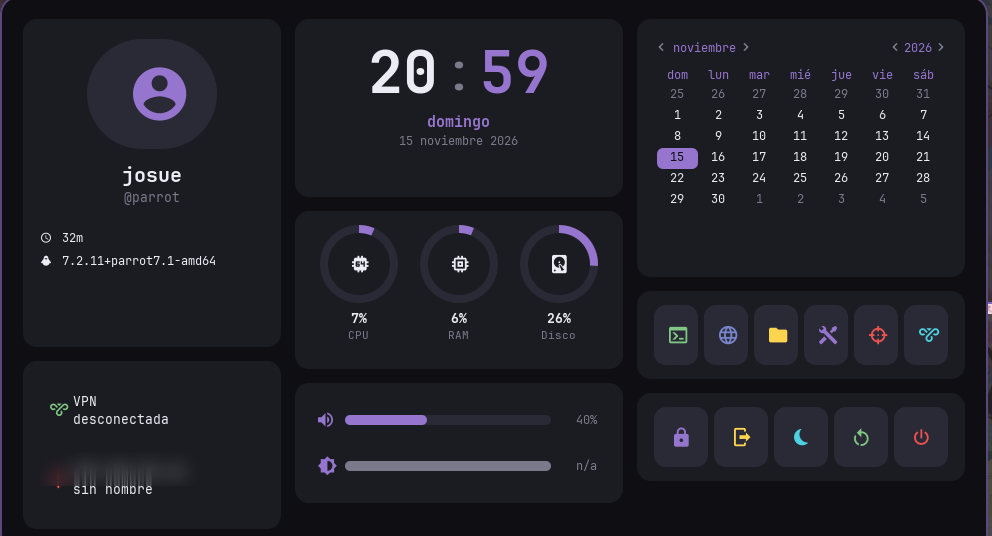
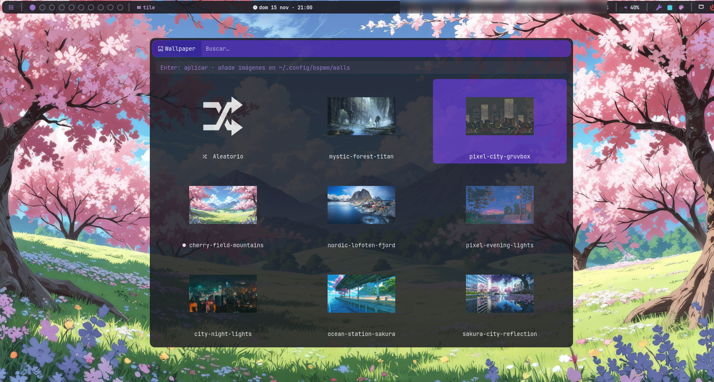
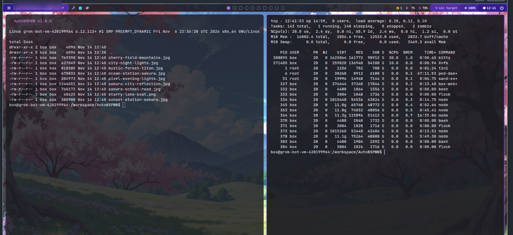

<div align="center">

# 🪻 AutoBSPWN

**Entorno [BSPWM](https://github.com/baskerville/bspwm) listo para pentesting, pensado para Parrot OS Home.**
Barra limpia y redondeada · dashboard eww · animaciones y blur · bloqueo desenfocado · temas sincronizados · Target HUD · VPN switcher.

<br>


<br>



</div>

---

## Contenido

- [Instalación](#instalación) · [Actualizar](#actualizar)
- [Qué incluye](#qué-incluye) · [Novedades 3.4.0](#novedades-340) · [Novedades 3.3.1](#novedades-331) · [Novedades 3.3.0](#novedades-330)
- [Atajos esenciales](#atajos-esenciales)
- [Flujo de pentest](#flujo-de-pentest)
- [Herramientas de Parrot Security](#herramientas-de-parrot-security-opcional)
- [Temas y wallpapers](#temas-y-wallpapers)
- [Compatibilidad](#compatibilidad)
- [Créditos](#créditos)

---

## Instalación

```bash
git clone https://github.com/Josue-Quiroa/AutoBSPWN.git
cd AutoBSPWN
./Install.sh
```

Cierra sesión y, en el login (LightDM / SDDM), elige la sesión **`bspwm`**.
Tu escritorio MATE o KDE sigue intacto. Dentro, pulsa **`Super`+`F1`** para ver todos los atajos.

| Comando | Qué hace |
|---|---|
| `./Install.sh` | Interactivo: pregunta si instalar tools de pentest |
| `./Install.sh -y` | Sin preguntas, sin tools |
| `./Install.sh -y --tools basic` | Sin preguntas, con tools básicas |
| `./Install.sh --list-tools` | Lista categorías de tools y sale |
| `./Install.sh --update` | Sólo sincroniza dotfiles/scripts/temas (ver [Actualizar](#actualizar)) |

> **Requisitos:** usuario con `sudo` (no root), sesión **X11**, ~1 GB libre. Parrot 6/7 Home, Parrot Security o Kali rolling.

<details>
<summary>Todas las flags del instalador</summary>

```
-y, --yes              sin preguntas (tools = none salvo --tools)
--tools MODO           none | basic | pentest | full | custom:cat1,cat2
--list-tools           ver categorías/metapaquetes de tu distro y salir
--skip-upgrade         no hacer full-upgrade / parrot-upgrade
--skip-fonts           no descargar Nerd Fonts
--disable-backports    comentar repos *-backports de Parrot (opt-in)
--update               sólo configs/scripts/temas/wallpapers/ATAJOS (sin apt, upgrade, fuentes ni tools)
-n, --nickname NAME    obsoleta (se ignora; los fondos ya no llevan texto)
```
</details>

### Actualizar

```bash
autobspwn-update
```

Hace `git pull --ff-only` en tu clon de AutoBSPWN y luego `./Install.sh --update`: **sólo** vuelve a copiar dotfiles, scripts, temas, wallpapers y `ATAJOS.md` (sin `apt`, sin upgrade, sin fuentes, sin tools), con backup previo en `~/.config/autobspwn-backup-*`, y recarga bspwm, polybar y sxhkd si están corriendo. Es idempotente y tarda unos segundos.

- **Tus cambios no se pisan.** El instalador recuerda qué versión de cada archivo dejó (`~/.config/autobspwn/manifest.tsv`). Si editaste uno (p. ej. `sxhkdrc` o `.zshrc`), se conserva el tuyo y la versión nueva queda al lado como `archivo.autobspwn-new` para que la compares. `targets.tsv`, `target-commands.conf` y los `scope.conf` son tuyos: sólo se crean si faltan. Tu tema actual se mantiene.
- Alias y exports propios: ponlos en `~/.zshrc.local` (nunca se toca) y así `.zshrc` sigue recibiendo mejoras.
- Encuentra el clon en `~/.config/autobspwn/repo` (lo escribe el instalador), `$AUTOBSPWN_REPO`, `~/AutoBSPWN`, `~/git/`, `~/tools/`, `~/Downloads/`… Si no hay ninguno te dice cómo clonarlo: `git clone https://github.com/Josue-Quiroa/AutoBSPWN ~/AutoBSPWN && autobspwn-update --repo ~/AutoBSPWN`.
- `autobspwn-update --no-pull` sincroniza sin tocar git; si el pull no es fast-forward (cambios locales) no hace nada y te lo explica.
- ¿Algo salió mal? `autobspwn-update --rollback` vuelve a los dotfiles de antes del último update (`--list-backups` para elegir otro) y `autobspwn-doctor` revisa dependencias y configs.

---

## Qué incluye

| Pieza | Detalle |
|---|---|
| 🧩 **Polybar** | Una barra flotante redondeada, sin bloques encimados: launcher · escritorios · modo · reloj · Target HUD · VPN/IP · sistema · volumen · tools/portapapeles/tema · bandeja · power. En pantallas < 1366 px se compacta sola |
| 📊 **Dashboard** | **eww** (`Super`+`F2`): perfil, reloj grande, calendario, CPU/RAM/disco, sliders de volumen y brillo, accesos rápidos, VPN + target y botones de apagado |
| 🎨 **Temas** | 10: `amethyst` (defecto), Catppuccin `mocha` · `macchiato` · `frappe`, `tokyonight`, `nord`, `gruvbox`, `dracula`, `rosepine` y `hacker` — sincronizan polybar, bspwm, kitty, rofi, dunst, eww, lock y wallpaper |
| 🖼️ **Wallpapers** | 11 fondos anime/paisaje/pixel-art (uno por tema) + selector con miniaturas |
| 🐱 **Kitty** | JetBrainsMono NF, opacidad, pestañas redondeadas, divisiones |
| ✨ **Picom** | Esquinas redondeadas, **blur** `dual_kawase` y **animaciones** (abrir/cerrar con zoom, deslizar al cambiar de escritorio) |
| 🔒 **Bloqueo** | **i3lock** de los repos sobre tu wallpaper **desenfocado** (ImageMagick) con usuario@host; instantáneo, nada que compilar |
| 🪟 **Ventanas** | Mosaico automático o **modo flotante** por escritorio; flotantes se mueven **y redimensionan** (ratón y teclado) |
| 🔎 **Rofi** | Menús compactos con iconos y esquinas redondeadas |
| 🎯 **Pentest** | Target HUD con targets guardados, comandos rápidos, **scope guard**, recon `tscan`, **loot ledger** y timeline por target; VPN/lab switcher, portapapeles, launcher de tools |
| ⚡ **Extras** | Calendario, hoja de atajos, capturas, menú de escritorio, scratchpad con hasta 4 terminales tmux (Alt+1…4) |

### Novedades 3.4.0

<details open>
<summary>Doctor, rollback, modo presentación, notas rápidas y HiDPI / multi-monitor</summary>

- **`autobspwn-doctor`**: revisa programas y versiones (polybar, tmux, eww, xdotool, yad, greenclip, notify-send, dunstctl…), fuentes, los configs desplegados contra el manifest (borrados / editados por ti), los `*.autobspwn-new` pendientes, permisos y backups. Salida `OK / WARN / FAIL` con la orden para arreglarlo; exit `0` todo bien · `1` avisos · `2` fallos. Nunca usa sudo ni cambia nada. `--quiet` muestra sólo los problemas.
- **`autobspwn-update --rollback`**: vuelve a los dotfiles de antes del último update (`--list-backups` los lista numerados; `--rollback N` o `--rollback <nombre>` elige otro). Tus targets, favoritos, focus y comandos rápidos no se tocan, lo que había se guarda antes en un backup `…-rollback` (así el rollback también se deshace) y repetirlo no cambia nada. Recarga bspwm/sxhkd/polybar si corren.
- **Modo presentación / grabación** (`Super`+`F12`): la barra deja de mostrar el target, la IP de la VPN y la IP local, las notificaciones de dunst se pausan (`dunstctl set-paused`) y aparece **REC** en rojo (clic = salir). Se guarda en `~/.config/autobspwn/state`, así que sigue activo tras recargar o reiniciar.
- **Notas rápidas** (`Super`+`Alt`+`n`, o `note texto` en la terminal): una línea con fecha y hora al `~/targets/<ip>/notes.md` del target activo (y una entrada en su `timeline.tsv`, sin el texto) o a `~/notes/inbox.md` si no hay target. El texto y el nombre del target nunca se ejecutan.
- **HiDPI y multi-monitor automáticos** (`monitors.sh`): DPI por monitor a partir del tamaño físico que da `xrandr` (96/120/144/168/192; en VMs 96, o 192 si la pantalla es 4K) → `Xft.dpi` (kitty y GTK), DPI de rofi y una polybar por monitor con altura y fuentes escaladas. Al conectar o desconectar un monitor lo enciende/apaga, reparte los escritorios (2 monitores: I–V / VI–X; `Super`+`1…0` va al escritorio global) y relanza las barras. Ajustes en `~/.config/autobspwn/state`: `dpi=144` (forzar), `desktops=each` (I–X en cada monitor, como antes), `xrandr=off` (no tocar salidas).

</details>

### Novedades 3.3.1

<details open>
<summary>Scratchpad con varias terminales (Super+u)</summary>

- El scratchpad de **Super+u** ahora guarda **hasta 4 terminales** tmux, como pestañas: la barra de abajo muestra las abiertas (número + nombre, la activa resaltada) y el contador `n/4`, igual que Super+Tab pero dentro del scratchpad.
- Teclas sin prefijo: **Alt+1…4** ir a la terminal · **Alt+←/→** o **Alt+h/l** anterior/siguiente · **Alt+n** nueva (con 4 abiertas avisa «máx 4» y no crea más) · **Alt+w** cerrar la actual. `Ctrl+b` sigue funcionando.
- El límite es real: un hook de tmux cierra cualquier 5.ª ventana, venga de Alt+n, `Ctrl+b c` o `tmux new-window`.
- Usa su propio config `~/.config/autobspwn/scratch.tmux.conf` en un servidor tmux aparte (`tmux -L autobspwn-scratch`), así que tu `~/.tmux.conf` y tus otras sesiones no se tocan. Si lo editas, `autobspwn-update` respeta tus cambios. Los colores siguen al tema de kitty.

</details>

### Novedades 3.3.0

<details open>
<summary>Actualizar sin reinstalar, scope guard, recon, loot y tests</summary>

- **`autobspwn-update`** (y `./Install.sh --update`): `git pull` + resincronizar sólo los dotfiles, rápido y sin pisar los archivos que editaste. → [Actualizar](#actualizar)
- **Scope guard:** `~/targets/<ip>/scope.conf` con `in:` / `out:` (CIDR, IP, rangos, hosts, `*.dominio`). `scope-check`, los wrappers de `nmap`/`ffuf`, `tscan` y el menú del target bloquean lo que está fuera (salvo `--force`) y la barra pone el target **en rojo**. → [Scope](#-scope-guard)
- **`tscan fast|full|udp|ad`:** recon con resultados fechados en `~/targets/<ip>/nmap/`, `ports.txt` siempre al día (así `{ports}` de los comandos rápidos ya no sale vacío) y aviso con los puertos **nuevos**. → [Recon](#-recon-con-tscan)
- **Loot ledger + timeline:** `loot <etiqueta> archivo` (o `cmd | loot etiqueta`) guarda en `loot/`, copia al portapapeles y lo registra con hora, herramienta, origen y sha256; cada acción del HUD queda en `timeline.tsv`. `~/targets` pasa a `0700`. → [Loot](#-loot-y-timeline)
- **Tests + CI:** suite `bats` (54 pruebas: helpers, scope, targets, tscan, loot, tools, instalador) y GitHub Actions con shellcheck + bats en cada push/PR.
</details>

<details>
<summary>Qué trajo 3.2.0: targets guardados, comandos rápidos y 6 temas nuevos</summary>

- **Targets guardados (favoritos):** guarda varias máquinas (`ip`, nombre y una etiqueta como «HTB · AD») en `~/.config/bspwm/targets.tsv`. `Super`+`Alt`+`i` las lista y elegir una la vuelve el target activo al instante; desde `Super`+`i` puedes guardar/quitar el actual. «Cambiar target» mezcla guardados (★) e historial reciente.
- **`tgt <nombre|ip>`** en zsh activa ese target y te mete en `~/targets/<ip>/` (con autocompletado). `tgt` sin nada sigue yendo a la carpeta del target activo.
- **Comandos rápidos propios** en el menú del target: escribe `Etiqueta | comando` en `~/.config/bspwm/target-commands.conf` con `{ip} {name} {dir} {ports}` y aparecen en `Super`+`i`.
- **6 temas nuevos** con paletas oficiales y fondo a juego: **Tokyo Night, Nord, Gruvbox dark, Dracula, Rosé Pine y Catppuccin Frappé**. El selector (`Super`+`Alt`+`t`) muestra el nombre de cada uno.
</details>

<details>
<summary>Correcciones de 3.1.1</summary>

- **Redimensionar ventanas flotantes:** `Super`+`Alt`+`←/→` las hace más estrechas/anchas y `↑/↓` más bajas/altas (antes sólo crecían); `Super`+`Alt`+`Shift`+flechas encoge siempre. Con el ratón: `Super`+arrastre derecho (esquina) o `Super`+arrastre central (un lado).
- **Bloqueo nuevo:** adiós betterlockscreen / i3lock-color (fallaba al compilar en Parrot, pixelaba y su cadena de respaldo podía lanzar un **segundo** bloqueo tras desbloquear, que parecía "rechazar" la contraseña). Ahora es **i3lock** de los repos con una imagen desenfocada pre-generada: entra al instante y sólo hay un bloqueador.
- **Polybar rehecha:** una sola barra redondeada con separadores sutiles; el centro ya no se monta sobre los lados (antes `fixed-center` + barra transparente hacían que los bloques se encimaran en pantallas de VM).
- **Dashboard eww** (`Super`+`F2`, `Esc` cierra) al estilo adi1090x, con toque pentest (IP de la VPN y target activo).
</details>

<details>
<summary>Qué trajo 3.1</summary>

- **Picom con animaciones + blur.** En picom 12+ (Parrot 7, Kali): ventanas que aparecen/desaparecen con zoom, deslizan al cambiar de escritorio y se recolocan suave. En picom 10 (Parrot 6): fade + blur. En VMs: fade, sin blur ni animaciones para que todo vaya fluido.
- **Opacidad inteligente:** kitty y rofi translúcidos con blur; **Burp, navegadores, Wireshark y Ghidra siempre al 100 %** para que las capturas de PoC salgan limpias.
- **Modo flotante por escritorio:** `Super`+`Shift`+`s` alterna entre mosaico automático y acomodar libre con el ratón; el icono de la barra muestra el modo.
</details>

---

## Atajos esenciales

La lista completa (≈80 atajos + comandos) está en **[`ATAJOS.md`](ATAJOS.md)** y en pantalla con **`Super`+`F1`**.

| Teclas | Acción |
|---|---|
| `Super`+`Enter` | Terminal (kitty) |
| `Super`+`d` · `Super`+`Tab` | Lanzar apps · cambiar de ventana |
| `Super`+`i` · `Super`+`Alt`+`i` | 🎯 Target HUD · targets guardados |
| `Super`+`v` · `Super`+`Shift`+`v` | 🔐 VPN · reconectar |
| `Super`+`c` · `Super`+`p` | 📋 Portapapeles · 🧰 tools |
| `Super`+`w` · `Super`+`Shift`+`w` | 🖼️ Wallpapers · aleatorio |
| `Super`+`Shift`+`t` · `Super`+`Alt`+`t` | Ciclar tema · selector |
| `Super`+`Alt`+`c` | 📅 Calendario |
| `Print` · `Super`+`Print` | Captura de zona · pantalla |
| `Super`+`flechas` / `h j k l` | Mover el foco (`Shift` mueve, `Alt` redimensiona, `Alt`+`Shift` encoge) |
| `Super`+`s` · `Super`+`Shift`+`s` | 🪟 Ventana flotante↔mosaico · escritorio en modo flotante |
| `Super`+arrastre izq. / der. / central | Mover · redimensionar (esquina) · redimensionar (lado) |
| `Super`+`1`…`0` | Cambiar de escritorio (con varios monitores, I–X repartidos entre ellos) |
| `Super`+`F12` · `Super`+`Alt`+`n` | 🎥 Modo presentación (oculta IPs) · 📝 nota rápida |
| `Super`+`F2` | 📊 Dashboard eww (`Esc` o `Super`+`F2` lo cierran) |
| `Super`+`q` · `Super`+`Shift`+`x` | Cerrar ventana · 🔒 bloquear |

<p align="center">
  
  
</p>

<p align="center">
  
  
</p>

<p align="center">
  
</p>

---

## Flujo de pentest

### 🎯 Target HUD
La barra muestra el objetivo actual (**nombre · IP**; puertos con `AUTOBSPWN_BAR_PORTS=1`). Con `Super`+`i` abres el menú para copiar la IP, abrir `http/https`, entrar por **SSH**, lanzar el recon (**tscan** fast/full/udp/ad), editar el **scope**, ver el **timeline y el loot** o añadirlo a `/etc/hosts`. Todo se guarda en `~/targets/<ip>/` (`nmap/`, `loot/`, `notes.md`, `scope.conf`, `timeline.tsv`…; carpeta `0700`). En zsh, `tgt` te lleva a la carpeta del target.

**Varios targets (guardados).** Sólo hay un target *activo* (el de la barra), pero puedes tener una lista de máquinas guardadas en `~/.config/bspwm/targets.tsv` — una por línea, separada por tabuladores: `ip`, `nombre` y una etiqueta opcional:

```
10.10.11.42	certified.htb	HTB · AD
10.129.231.7	sau	HTB easy
```

- `Super`+`Alt`+`i` → lista de guardados; elige uno y pasa a ser el activo. Escribe `10.10.11.9 box etiqueta` para guardar uno nuevo.
- `Super`+`i` → **Guardar en targets** / **Quitar de guardados** para el actual; **Cambiar target** muestra guardados (★) + historial reciente.
- Terminal: `tgt certified.htb` (o `tgt 10.10.11.42`) lo activa y hace `cd` a su carpeta; `targetFav add|rm|list|use` para gestionarlos a mano.

**Comandos rápidos.** Cada línea `Etiqueta | comando` de `~/.config/bspwm/target-commands.conf` aparece en `Super`+`i` cuando hay un target activo (la opción **Editar comandos rápidos** abre el archivo). Variables: `{ip}`, `{name}` (vacío si no tiene), `{dir}` (`~/targets/<ip>`, se crea) y `{ports}` (lista con comas de `ports.txt`). Se ejecuta con bash en la carpeta del target, en una terminal que espera `Enter`. Los valores llegan como variables entrecomilladas: un nombre raro nunca se ejecuta como código.

```
# Etiqueta | comando
Gobuster dir | gobuster dir -u http://{ip} -w /usr/share/wordlists/dirb/common.txt -o {dir}/gobuster.txt
Nmap UDP top | sudo nmap -sU --top-ports 50 {ip} -oN {dir}/udp.txt
Whatweb | whatweb http://{ip}
```

### 🚧 Scope guard
Cada target puede tener su `~/targets/<ip>/scope.conf` (se crea comentado; **Editar scope** en `Super`+`i`):

```
in:  10.10.11.0/24  10.129.0.0/16
in:  corp.local *.corp.local
out: 10.10.11.1  vpn.corp.local      # las exclusiones siempre ganan
```

- Entradas: IP, CIDR, rango `10.0.0.5-20`, `10.0.0.*`, host exacto o `*.dominio` (sólo subdominios; el dominio raíz va aparte). Sin líneas `in:` todo lo no excluido está dentro; sin reglas no se bloquea nada. Los nombres se comprueban por patrón y por `/etc/hosts` (nunca por DNS).
- `scope-check 10.10.11.5` → `in-scope` / `out-of-scope` / `no-scope` (`-v` dice qué regla decidió; salida 0/1/2). También es una función de `lib.sh` para tus scripts.
- **Bloqueo:** `nmap` y `ffuf` en `~/.local/bin` son guardias que comprueban sus objetivos (`-iL`, `-u` incluidos) antes de llamar al binario real; `tscan` y el menú del target también. Fuera de scope → notificación **crítica** y no se lanza; `--force` lo lanza igual y queda anotado en el timeline. `AUTOBSPWN_SCOPE_GUARD=0 nmap …` lo salta una vez; `touch ~/.config/autobspwn/no-scope-wrappers` + `autobspwn-update` quita los wrappers.
- La sección del target en la barra se pone **en rojo** («fuera de scope») si el target activo queda fuera.
- Ojo: `sudo nmap …` usa el PATH de sudo y no pasa por el guardia (por eso `tscan` hace su propia comprobación antes de pedir sudo).

### 🔭 Recon con tscan
`tscan fast|full|udp|ad [ip]` (o **Recon …** en `Super`+`i`) escanea el target activo:

| Perfil | Qué hace |
|---|---|
| `fast` | top 1000 TCP, SYN + versiones ligeras |
| `full` | los 65535 TCP y después `-sC -sV` sólo en los abiertos |
| `udp` | top 100 UDP (necesita root) |
| `ad` | 53, 88, 135, 139, 389, 445, 464, 593, 636, 3268/9, 3389, 5985/6, 9389… con scripts de LDAP/SMB/RDP |

Guarda `~/targets/<ip>/nmap/<perfil>-<fecha>.{nmap,gnmap,xml}`, compara con lo que ya conocías (`nmap/ports.tsv`, con servicio y fecha en que se vio por primera vez), actualiza `ports.txt` (TCP, `22,80,445` → `{ports}` en los comandos rápidos) y `ports-udp.txt`, y avisa con los puertos **nuevos**. Usa sudo si hace falta para SYN/UDP (te lo pide en la terminal) o `-sT` con `--no-sudo`. Respeta el scope (bloquea salvo `--force`).

### 💰 Loot y timeline

```bash
loot "NTLM admin" hashes.txt              # mueve a ~/targets/<ip>/loot/, copia la ruta
secretsdump.py … | loot dump-dc            # guarda loot/dump-dc.txt y copia el contenido
loot --list                                # el registro
```

`loot/index.tsv` anota hora, etiqueta, **herramienta**, origen y **sha256** de cada pieza (archivos `0600`). La herramienta sale de `-t`, del otro lado de la tubería o del comando anterior en zsh; **sólo se guarda el nombre del programa, nunca sus argumentos** (pueden llevar contraseñas) ni el contenido. Cada acción del menú del target (copiar IP, ssh, recon, comandos rápidos…, `--force` incluidos) se añade a `~/targets/<ip>/timeline.tsv` — útil para el informe. **Timeline y loot del target** en `Super`+`i` lo muestra.

### 🔐 VPN / lab switcher
`Super`+`v` lista tus perfiles de `~/vpn/*.ovpn`, WireGuard y las conexiones de NetworkManager. Conectar uno desconecta los demás (modo lab); la barra muestra el perfil, la IP y la interfaz del túnel. Pide la contraseña **una sola vez** por acción (sudo cacheado → pkexec → terminal).

### 📋 Portapapeles · 🧰 Tools
`Super`+`c` abre el historial del portapapeles (greenclip, con copyq de respaldo; ignora gestores de contraseñas). `Super`+`p` abre un menú con solo las herramientas instaladas (Burp, Wireshark, BloodHound, Ghidra…); las apps Java arrancan sin ventanas grises.

---

## Herramientas de Parrot Security (opcional)

Parrot Home no trae las tools de pentest. El instalador las ofrece y nunca aborta si algo falla (reintenta por metapaquete y lo deja en el log). Se instalan al final, así el entorno queda listo aunque una falle.

| Flag | Parrot | Kali | Tamaño aprox. (Parrot 6 / 7) |
|---|---|---|---|
| `--tools none` | — | — | 0 |
| `--tools basic` | recon · web · passwords · post-exploit | `kali-tools-top10` | ~5 GB / ~9 GB |
| `--tools pentest` | basic + explotación + sniffing | `kali-linux-default` | ~7 GB / ~11 GB |
| `--tools full` | `parrot-tools-full` | `kali-linux-large` | ~10 GB / ~15 GB |
| `--tools custom:web,password,…` | `parrot-tools-<cat>` | `kali-tools-<cat>` | depende |

> Los tamaños son estimaciones sobre el índice oficial de Parrot (nov 2026, con *Recommends*); varían según el mirror. Instálalas después con `./Install.sh -y --skip-upgrade --tools pentest`.

---

## Temas y wallpapers

Un solo cambio de tema (`Super`+`Shift`+`t`) reaplica colores en **polybar, bordes, kitty, rofi, dunst, lock y wallpaper** a la vez (también el dashboard y la imagen de bloqueo). Cada tema trae su fondo; con `Super`+`w` eliges entre los 11 incluidos (con miniaturas) y `Super`+`Shift`+`w` pone uno al azar.

| Tema | Paleta | Wallpaper |
|---|---|---|
| `amethyst` (defecto) | morado Material «Deep Purple» | `cherry-field-mountains.jpg` |
| `mocha` | Catppuccin Mocha | `sunset-station-sakura.jpg` |
| `macchiato` | Catppuccin Macchiato | `starry-lake-boat.png` |
| `frappe` | Catppuccin Frappé | `mystic-forest-titan.jpg` |
| `tokyonight` | Tokyo Night | `pixel-evening-lights.jpg` |
| `nord` | Nord | `nordic-lofoten-fjord.jpg` |
| `gruvbox` | Gruvbox dark | `pixel-city-gruvbox.png` |
| `dracula` | Dracula | `sakura-city-reflection.jpg` |
| `rosepine` | Rosé Pine | `sakura-school-road.jpg` |
| `hacker` | verde fósforo sobre negro | `city-night-lights.jpg` |

Tus propios temas: copia uno de `~/.config/bspwm/themes/*.theme` + `~/.config/polybar/themes/*.ini` con otro nombre; los colores que falten en la barra se rellenan solos.

Para que cambiar de tema **no** te cambie el fondo: `touch ~/.config/bspwm/.no-theme-wall`.
Fuentes de cada imagen en [`wallpapers/CREDITS.md`](wallpapers/CREDITS.md).

---

## Compatibilidad

Detecta automáticamente **Parrot Home / Security / Kali** y adapta nombres de paquetes, versión de polybar (3.6 y 3.7) y de picom (10 y 12+). Convive con MATE y KDE sin romperlos:

<details>
<summary>Detalles de convivencia con MATE / KDE</summary>

- La sesión bspwm no arranca marco, mate-panel, caja-desktop ni el compositor de MATE.
- Notificaciones: dunst solo dentro de bspwm; el daemon nativo (MATE/KDE/XFCE) en sus sesiones, vía un router en `~/.local/share/dbus-1/services/`.
- El autostart global de `picom` se desactiva para tu usuario; bspwm lo lanza por su cuenta.
- nm-applet, agente polkit y portapapeles se arrancan una sola vez.
- Caja se abre con `--no-desktop` para no tapar el wallpaper.
- `nmap`, `openvpn` y `wireguard-tools` se instalan siempre (los usan el HUD y la VPN).
</details>

<details>
<summary>Notas y resolución de problemas</summary>

- No ejecutar como root. Log completo en `~/.cache/autobspwn-install-*.log`; backup en `~/.config/autobspwn-backup-*`.
- apt espera hasta 10 min por el lock y reintenta `apt update`; si falla, sigue con la caché.
- Polybar sin iconos → `fc-cache -fv` y reinstala sin `--skip-fonts`.
- `wg-quick` con `DNS =` puede necesitar `openresolv`/`resolvconf`.
- Actualizar desde v2.x: `./Install.sh --skip-upgrade -y` (mueve los fondos viejos con texto al backup). Desde 3.x basta `autobspwn-update` (o `./Install.sh --update`).
- Tests: `./tests/run.sh` (bats-core incluido en `tests/vendor/`); CI en `.github/workflows/ci.yml`.
- Nada requiere GPU: en VMs picom usa `xrender` (esquinas redondeadas y fade, sin blur ni animaciones). ¿VM con aceleración 3D? `echo full > ~/.config/picom/profile` fuerza el perfil completo (`lite` hace lo contrario).
- Si las animaciones se sienten pesadas al arrastrar ventanas, borra el bloque `geometry` de `~/.config/picom/picom-rules.conf`.
- Bloqueo: la imagen está en `~/.cache/autobspwn/lock.png` y se regenera sola al cambiar wallpaper, tema o resolución (`~/.config/bspwm/scripts/lock.sh --update` la fuerza). Sin ImageMagick es un fondo liso del tema. Si vienes de 3.1.0 en Kali, el instalador cambia i3lock-color/betterlockscreen por i3lock.
- Dashboard: eww no está en los repos; se instala el binario incluido en `bin/` (eww v0.6.0, verificado por SHA-256) en `~/.local/bin/eww`. Si no arranca y no hay rustc ≥ 1.76 para compilarlo, `Super`+`F2` avisa con una notificación. El daemon de eww sólo corre mientras el dashboard está abierto. Brillo: sólo con `brightnessctl` y un backlight real (en VMs aparece `n/a`).
- Barra compacta: en monitores de menos de 1366 px se ocultan textos secundarios (fecha, "VPN off", nombre del target). Forzar: `AUTOBSPWN_BAR_COMPACT=0` o `1` en `~/.xprofile`.
</details>

---

## Créditos

Inspirado en el trabajo de la comunidad; **todo el código y las configs están escritos desde cero** para AutoBSPWN (r1vs3c y yoodreamer no publican licencia, así que no se copió nada de ellos):

- **[r1vs3c/auto-bspwm](https://github.com/r1vs3c/auto-bspwm)** — inspiración visual: barra de píldoras moradas, bordes finos, gaps, estilo de rofi y kitty.
- **[adi1090x/polybar-themes](https://github.com/adi1090x/polybar-themes) · [adi1090x/widgets](https://github.com/adi1090x/widgets)** — ideas de barra y del dashboard (config propia).
- **[elkowar/eww](https://github.com/elkowar/eww)** (MIT) — motor del dashboard; binario v0.6.0 compilado sin cambios en `bin/` (ver [`bin/README.md`](bin/README.md)).
- **[pijulius/picom](https://github.com/pijulius/picom) · [FT-Labs/picom](https://github.com/FT-Labs/picom)** — referencia del estilo de animaciones (aquí con los presets nativos de picom 12+).
- **[i3lock](https://i3wm.org/i3lock/)** (paquete de la distro) + **ImageMagick** para el fondo desenfocado del bloqueo.
- **[yoodreamer/AutoBSPWM](https://github.com/yoodreamer/AutoBSPWM)** — inspiración funcional: calendario en el reloj, menú de escritorio, ocultar/recuperar ventanas, foco por nodos, capturas.
- **Colores:** [Catppuccin](https://github.com/catppuccin/catppuccin) (MIT) y la paleta Material Design.
- **Wallpapers:** de sus respectivos autores — ver [`wallpapers/CREDITS.md`](wallpapers/CREDITS.md).

<div align="center">
<br>

Código bajo licencia **MIT** · hecho para la comunidad de Parrot y Kali 🦜

<sub>🤖 Parte del desarrollo se hizo con ayuda de Grok.</sub>

</div>
