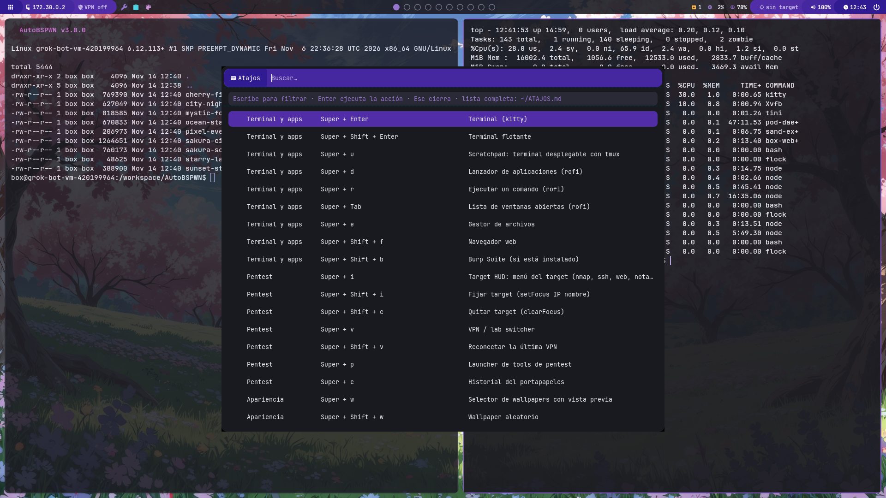

# AutoBSPWN v3.0.0

Entorno **BSPWM** de alto nivel pensado para **Parrot OS Home Edition** (también funciona en Parrot Security y Kali; VMs y metal). Barra con estilo de “píldoras”, **ventanas con esquinas redondeadas**, 9 wallpapers anime/paisaje, 4 temas sincronizados, calendario, hoja de atajos, scratchpad, lock, **Target HUD**, **VPN/lab switcher**, **historial de portapapeles**, **launcher de tools** y, opcionalmente, **las herramientas de la edición Security de Parrot**.


<p align="center">
  
  
</p>

## Requisitos

- **Parrot OS 6.x Home** ("lory", Debian 12, MATE) o **Parrot OS 7.x Home** ("echo", Debian 13, KDE Plasma). También Parrot Security y Kali rolling. Otros Debian: *best-effort*.
- Usuario normal con `sudo` (no ejecutar como root), conexión a Internet.
- Sesión **X11** (bspwm no funciona en Wayland). El login (LightDM en MATE, SDDM en KDE) muestra la sesión `bspwm`.
- Espacio: ~1 GB para el entorno. Las tools de pentest son opcionales y ocupan bastante más (ver tabla abajo).

## Instalación

```bash
cd AutoBSPWN
chmod +x Install.sh
./Install.sh                          # interactivo: pregunta si instalar tools
./Install.sh -y                       # sin preguntas, SIN tools (-y sin --tools = none)
./Install.sh -y --skip-upgrade --tools basic     # sin preguntas, con tools básicas
```

Cierra sesión → en el login elige **bspwm**. Tu escritorio MATE/KDE sigue intacto y disponible.
Al entrar: **Super+F1** muestra todos los atajos (también en `~/ATAJOS.md`).

## Novedades v3.0

### Look nuevo (inspirado en r1vs3c/auto-bspwm)
- **Polybar acoplada arriba** (30 px, reserva su espacio) con bloques en forma de píldora:
  launcher · IP · VPN | tools · portapapeles · tema — escritorios con puntos al centro —
  updates · CPU · RAM · batería · bandeja | **target** · volumen · **reloj** · apagado.
  Funciona igual en polybar **3.6.3** (Parrot 6) y **3.7.x** (Parrot 7 / Kali); en 3.7 la
  bandeja usa `internal/tray` (barra `main-tray`) y en 3.6 `tray-position`.
- Tema nuevo por defecto **amethyst** (morado/violeta, Material) + `mocha`, `macchiato`, `hacker`
  adaptados al nuevo diseño (cada tema define sus 3 tonos de píldora).
- Bordes de bspwm finos (**2 px**), gaps de 10 px, **esquinas redondeadas (radio 10)**.
- kitty con pestañas redondeadas, transparencia y divisiones (`Ctrl+Shift+Enter`).
- rofi compacto con esquinas redondeadas, barra de búsqueda coloreada por el tema.
- **Ya no hay texto en el fondo**: se eliminó el wallpaper generado con el nick
  (`--nickname` se acepta pero se ignora).

### Wallpapers
- 9 fondos incluidos en `wallpapers/` (→ `~/.config/bspwm/walls/`), optimizados (≈5 MB en total).
  Créditos y fuentes en [`wallpapers/CREDITS.md`](wallpapers/CREDITS.md).
- Por defecto (primer login y tema amethyst): `cherry-field-mountains.jpg`
  (paisaje anime: campo y montañas entre cerezos).
- Cada tema tiene su fondo: amethyst → cerezos · mocha → `sunset-station-sakura` ·
  macchiato → `starry-lake-boat` · hacker → `city-night-lights`.
- **Super+w**: selector rofi con **miniaturas** (cacheadas en `~/.cache/autobspwn/wall-thumbs`);
  **Super+Shift+w**: aleatorio. Para que cambiar de tema no cambie tu fondo:
  `touch ~/.config/bspwm/.no-theme-wall`. Añade tus imágenes a `~/.config/bspwm/walls/`.

### Esquinas redondeadas (picom) en VM y en metal
- `bspwmrc` detecta la versión de picom (`picom --version`):
  - **picom ≥ 12** (Parrot 7, Kali): usa `picom-rules.conf` / `picom-rules-vm.conf` (sintaxis nueva `rules:`).
  - **picom 10/11** (Parrot 6 / Debian 12): usa `picom.conf` / `picom-vm.conf` (sintaxis clásica).
- **Metal**: backend `glx` + vsync (sombras, fades, transparencia). **VM** (detectada con
  `systemd-detect-virt` o DMI: VirtualBox, VMware, QEMU/KVM, Hyper-V…): backend `xrender`
  sin vsync — las **esquinas redondeadas también funcionan** (xrender las soporta desde picom 9).
  Si el perfil falla, se reintenta con el de VM y luego con `picom --backend xrender`.
- La barra, dunst y los menús no se redondean (quedan pegados al borde), sólo las ventanas.

### Funciones nuevas (inspiradas en yoodreamer/AutoBSPWM)
- **Calendario**: clic en el reloj (o `Super+Alt+c`). Usa **yad** (`--calendar`, tema oscuro,
  aparece bajo el reloj, se cierra al perder el foco o con otro clic). Respaldo: `gsimplecal`,
  y si no hay ninguno, `cal -3` en una terminal flotante. Clic derecho en el reloj = fecha completa.
- **Hoja de atajos**: `Super+F1` o `Super+/` → rofi con **todos** los atajos leídos del `sxhkdrc`
  (filtrable; Enter ejecuta). `keys-help.sh --markdown` regenera `ATAJOS.md`.
- **Ocultar / recuperar ventanas**: `Super+n` / `Super+Shift+n`.
- **Capturas**: `Print` o `Super+a` (zona, flameshot), `Super+Print` (pantalla), `Super+Shift+Print`
  (ventana), `Super+Ctrl+Print` (5 s). Se guardan en `~/Pictures/Screenshots` y se copian al portapapeles.
- **Menú del escritorio** con clic derecho sobre el fondo (jgmenu, colores del tema) o `Super+Shift+m`.
- **Redimensionado inteligente** (`Super+Alt+flechas`), mover/intercambiar (`Super+Shift+flechas`,
  mueve si la ventana es flotante), flags (`Super+Ctrl+m/x/y/z`), foco a padre/hermano,
  historial de foco (`Super+grave`, `Super+o`), gaps en vivo (`Super+Alt+=/-`), ocultar barra (`Super+b`).
- Info del sistema: clic derecho en el launcher de la barra (fastfetch/neofetch).

## Parrot Home: qué detecta y cómo convive con MATE/KDE

- Detecta **Parrot Home vs Parrot Security vs Kali**: Parrot por `/etc/os-release` (ID, nombre, codename `lory`/`echo`), `parrot-core` o los repos `deb.parrot.sh`; *Security* si está `parrot-tools-full` o ≥3 metapaquetes `parrot-tools-*` (el `os-release` dice "Parrot Security" en ambas ediciones, por eso se miran los paquetes).
- Los nombres de paquetes están verificados en los índices de Parrot 6 (lory), Parrot 7 (echo) y Kali. Si alguno no existe en tus repos se **omite con aviso** (no aborta). Nombres alternativos: `network-manager-applet`/`network-manager-gnome`, `fastfetch`/`neofetch`, `copyq` como respaldo de greenclip. `wmname` viene de `suckless-tools`.
- Polybar **3.6.x** (Parrot 6) y **3.7.x** (Parrot 7/Kali): misma config; la bandeja usa `tray-position` en 3.6 e `internal/tray` en 3.7 (polybar 3.7 avisa que `content` está obsoleto en los módulos de texto; se mantiene a propósito porque 3.6 no entiende `format` ahí).
- picom **10.x** (Parrot 6) y **12.x/13.x** (Parrot 7/Kali): config elegida automáticamente (ver *Esquinas redondeadas*).
- **Siempre** instala lo que usan el HUD y la VPN también en Home: `nmap`, `openvpn`, `wireguard-tools`, `network-manager-openvpn(-gnome)`.
- **Convivencia con MATE/KDE**:
  - La sesión bspwm no arranca marco, mate-panel, caja-desktop ni el compositor de MATE: bspwm no ejecuta el autostart XDG; `bspwmrc` sólo lanza lo suyo y salta picom si ya hay otro compositor (marco/compiz/kwin/xfwm4).
  - Notificaciones: dunst, `mate-notification-daemon`, `xfce4-notifyd` y Plasma reclaman el mismo nombre D-Bus. El instalador crea `~/.local/share/dbus-1/services/org.freedesktop.Notifications.service` → `~/.local/bin/autobspwn-notifyd`: **dunst sólo dentro de bspwm**, el daemon nativo en MATE/KDE/XFCE. En bspwm, `bspwmrc` cierra el daemon rival antes de arrancar dunst.
  - El paquete `picom` trae un autostart para *todos* los escritorios; se desactiva para tu usuario (`~/.config/autostart/picom.desktop` con `Hidden=true`) para que no pelee con marco/kwin. bspwm lo lanza él solo.
  - nm-applet, agente polkit (MATE/KDE/GNOME/LXQt) y portapapeles se arrancan **una sola vez** (se comprueba antes).
  - Caja se abre con `--no-desktop` (Super+e) para que no tape el wallpaper de bspwm.
  - `~/.config/gtk-3.0/settings.ini` (tema oscuro + Papirus) sólo se crea si no tenías uno; MATE/KDE usan su propia configuración en sus sesiones.
- Los repos `backports` de Parrot ya **no** se tocan por defecto (antes se comentaban). Si quieres hacerlo: `--disable-backports` (con copia `.autobspwn.bak`).

## Herramientas de Parrot Security (opcional)

Parrot Home no trae las tools de pentest. El instalador pregunta:

```
Herramientas de pentest de la edición Security
   1) No instalar tools  (por defecto)
   2) Básicas: recon, web, passwords y post-explotación
   3) Pentest: básicas + explotación (Metasploit, NetExec…) + sniffing (Wireshark, Responder…)
   4) Todas (parrot-tools-full)
   5) Elegir categorías
```

Si ya tienes Parrot Security o Kali con metapaquetes, lo detecta y puedes omitirlo (apt sólo añade lo que falte).

| Opción / flag | Parrot | Kali | Tamaño aprox. Parrot 6 | Tamaño aprox. Parrot 7 |
|---|---|---|---|---|
| `--tools none` | nada | nada | 0 | 0 |
| `--tools basic` | `parrot-tools-infogathering` `parrot-tools-web` `parrot-tools-password` `parrot-tools-postexploit` | `kali-tools-top10` | ~5.2 GB (1.6 GB descarga) | ~8.7 GB (2.5 GB descarga) |
| `--tools pentest` | basic + `parrot-tools-pwn` `parrot-tools-sniff` `impacket-scripts` | `kali-linux-default` | ~7.1 GB (2.1 GB) | ~10.9 GB (3.2 GB) |
| `--tools full` | `parrot-tools-full` | `kali-linux-large` | ~10.3 GB (2.9 GB) | ~15.2 GB (4.7 GB) |
| `--tools custom:web,password,…` | `parrot-tools-<cat>` | `kali-tools-<cat>` | depende | depende |

- Los tamaños son **estimaciones** sobre una Parrot Home calculadas con el índice oficial de paquetes (`deb.parrot.sh`, nov 2026, incluyendo *Recommends*); cambian con el mirror. Para Kali no se muestra estimación.
- Categorías Parrot: `infogathering web password postexploit pwn sniff vuln wireless forensics reversing maintain cloud reporting automotive ai` (`ai` sólo en Parrot 7). Lista completa: `./Install.sh --list-tools`.
- Los metapaquetes `parrot-tools-*` declaran sus herramientas como *Recommends*, así que se instalan con `--install-recommends` (el resto del entorno usa `--no-install-recommends` donde tiene sentido).
- Las tools se instalan **al final**: si algo falla, el entorno ya queda listo. Un fallo no aborta: reintenta por metapaquete y lo deja en el log.
- Antes de instalar comprueba el espacio libre en `/` y avisa si no alcanza.
- Más tarde: `./Install.sh -y --skip-upgrade --tools pentest` (o `AUTOBSPWN_TOOLS=full ./Install.sh -y`).

## Qué incluye

| Pieza | Detalle |
|-------|---------|
| Polybar | Píldoras, IPC, launcher/IP/VPN/tools/clip/tema/updates/CPU/RAM/batería/Target HUD/volumen/reloj+calendario/power (opcionales: netspeed, disco, temp) |
| Temas | `amethyst` (defecto), `mocha`, `macchiato`, `hacker` — sincroniza polybar, bspwm, kitty, rofi, dunst, jgmenu, lock y wallpaper |
| Wallpapers | 9 anime/paisaje incluidos + selector con miniaturas |
| Kitty | JetBrainsMono NF, opacidad, pestañas redondeadas, divisiones |
| Picom | Esquinas redondeadas (radio 10) en VM y metal; picom 10 y 12+ |
| Rofi | Compacto, iconos, esquinas redondeadas |
| Extras | Calendario (yad), hoja de atajos, capturas, menú de escritorio (jgmenu), ocultar ventanas |
| Scratchpad | `Super+u` (kitty+tmux) |
| Focus IP | `setFocus IP [nombre]` · clicks en polybar |
| Zsh | p10k (opcional), `mkt`, `ports`, lsd/bat — no requiere oh-my-zsh |

## Novedades v2.1 (flujo de pentest)

### Target HUD
- Módulo de polybar con el target actual: **nombre · IP · [puertos abiertos]**. Sin target muestra `sin target`.
- `Super+i` (o click izquierdo en el módulo) abre el menú: copiar IP/nombre, abrir `http/https` (y puertos web detectados: 8080, 8443, 3000…), **SSH** (usuario o `usuario:puerto`, `known_hosts` por target), **Nmap rápido** (top 1000) o **full TCP + `-sC -sV`**, terminal en la carpeta del target, notas, añadir a `/etc/hosts`, cambiar o limpiar target.
- Todo se guarda en `~/targets/<ip>/` (`nmap/`, `loot/`, `exploits/`, `notes.md`, `ports.txt`). Los puertos encontrados aparecen solos en la barra.
- Usa los mismos `setFocus` / `clearFocus` de siempre (ahora con historial de targets recientes). En zsh: `tgt` hace `cd` a la carpeta del target.
- Clicks del módulo: izq = menú · medio = copiar IP · der = fijar/cambiar target.

### VPN / lab switcher
- `Super+v` (o click izquierdo en el módulo VPN). Lista:
  - `~/vpn/*.ovpn` → OpenVPN (HTB, THM, OffSec…)
  - `~/vpn/*.conf` → WireGuard si tiene `[Interface]` (si no, OpenVPN)
  - conexiones `vpn` / `wireguard` de NetworkManager (`nmcli`)
- `●` = conectada (elegirla la desconecta). Conectar un perfil **desconecta los demás** (modo lab-switcher; `AUTOBSPWN_VPN_MULTI=1` para permitir varias).
- `Super+Shift+v` (o click medio) **reconecta** la última. También: desconectar todo, copiar IP del túnel, ver log de OpenVPN.
- Root: usa `sudo -n` si está cacheado, si no `pkexec` (agente polkit) y si no abre una terminal pidiendo la contraseña — **una sola vez** por acción.
- `.ovpn` con `auth-user-pass` sin archivo → se abre en terminal para escribir usuario/clave (cerrarla corta la VPN).
- La barra detecta **tun0, tun1, tap…, WireGuard con cualquier nombre** y VPNs de nmcli, y muestra perfil + IP + interfaz (`+N` si hay varias).

### Historial de portapapeles
- `Super+c` (o el icono de portapapeles en la barra). Backend **greenclip** (binario único de GitHub, modo rofi nativo, sin dependencias) arrancado desde `bspwmrc`.
- Si no se puede descargar (sin red / ARM), el instalador usa **copyq** de apt (también desde rofi). `clipmenu` no está empaquetado en Parrot/Kali; sólo se usa si lo instalaste tú.
- Config: `~/.config/greenclip.toml` (150 entradas, ignora KeePassXC/Bitwarden). Borrar historial: `clipboard.sh --clear`.

### Tema + wallpaper + apps sincronizados
- `Super+Shift+t` cicla `amethyst → mocha → macchiato → hacker`; `Super+Alt+t` (o el icono de pincel en la barra) abre el selector. Scroll sobre el icono también cicla.
- Un solo cambio aplica a **polybar, bordes bspwm, kitty (todas las ventanas, vía SIGUSR1), rofi (`colors.rasi`), dunst (`dunstctl reload`), i3lock y wallpaper**.
- Wallpaper por tema: `~/.config/bspwm/walls/<tema>.png|jpg|webp` si lo creas tú; si no, el `WALL=` del `.theme` (fondos incluidos). Nunca se dibuja texto. Para conservar tu fondo: `touch ~/.config/bspwm/.no-theme-wall`.
- CLI: `theme-sync hacker` · `theme-sync --next` · `theme-sync --list` (`polybar-theme` sigue funcionando).
- Tema propio: crea `~/.config/polybar/themes/<t>.ini` + `~/.config/bspwm/themes/<t>.theme`.

### Launcher de tools
- `Super+p` (o el icono de llave junto al launcher). Sólo muestra lo instalado: Burp, ZAP, Caido, Wireshark, BloodHound, Neo4j, Ghidra, Cutter, jd-gui, Metasploit, Armitage, Maltego, Remmina, Responder…
- Las apps Java se lanzan con `_JAVA_AWT_WM_NONREPARENTING=1` (sin ventanas grises en bspwm). Las de terminal se abren en kitty flotante.
- Agrega las tuyas en `~/.config/bspwm/tools.list`: `Nombre|java(0/1)|gui(0/1)|comando`.

## Atajos

La lista **completa** (≈80 atajos por categoría + comandos de terminal + kitty) está en
[`ATAJOS.md`](ATAJOS.md) y en pantalla con **Super+F1**. Los más usados:

| Teclas | Acción |
|--------|--------|
| Super+Enter / Super+Shift+Enter | Kitty / kitty flotante |
| Super+d · Super+r · Super+Tab | Apps · ejecutar · ventanas (rofi) |
| Super+e · Super+Shift+f | Archivos · navegador |
| Super+u | Scratchpad |
| **Super+i** · Super+Shift+i / c | **Target HUD** · fijar / quitar target |
| **Super+v** · Super+Shift+v | **VPN** · reconectar |
| **Super+c** · **Super+p** | **Portapapeles** · **tools** |
| Super+w · Super+Shift+w | Wallpapers (miniaturas) · aleatorio |
| Super+Shift+t · **Super+Alt+t** | Ciclar tema · **selector de tema** |
| **Super+F1** / Super+/ | **Hoja de atajos** |
| Super+Alt+c | Calendario |
| Print · Super+a · Super+Print | Captura de zona · zona · pantalla |
| Super+n · Super+Shift+n | Ocultar ventana · recuperar |
| Super+q / Super+Shift+q | Cerrar / matar ventana |
| Super+t · s · f · m · Shift+space | Tiled · flotante · fullscreen · monocle · alternar flotante |
| Super+flechas (o h/j/k/l) | Foco (Shift = mover/intercambiar, Alt = redimensionar, Ctrl = preseleccionar) |
| Super+1..0 · Super+Shift+1..0 | Escritorio · enviar ventana |
| Super+Shift+x / Ctrl+Alt+l · Super+Shift+e | Bloquear · menú de apagado |
| Super+Escape · Super+Shift+r (o Super+Alt+r) | Recargar sxhkd · reiniciar bspwm |

### Decisiones sobre atajos (al combinar ideas de r1vs3c y yoodreamer)
- Se mantienen **todos** los de AutoBSPWN (Super+i, v, c, p, Shift+t, Alt+t…); lo nuevo sólo usa combinaciones libres.
- `Super+w` sigue siendo **wallpapers** (en r1vs3c cierra la ventana; aquí cerrar es `Super+q`).
- No se copian los atajos de volumen con `Ctrl+Shift+flechas` de r1vs3c porque chocan con kitty.
- La preselección queda en `Super+Ctrl+dirección` y además en `Super+Ctrl+Alt+dirección` (estilo r1vs3c/yoodreamer).
- `Super+Shift+flechas` mueve la ventana si es flotante e intercambia si está en mosaico; `Super+Alt+flechas` crece hacia la flecha o encoge si no puede.
- Se comprobó que no hay combinaciones duplicadas en `sxhkdrc` (expandiendo las llaves `{…}`).

## Flags del instalador

```
./Install.sh --help
  -y, --yes              sin preguntas (zsh por defecto; tools = none salvo --tools)
  -n, --nickname NAME    obsoleta en v3 (se ignora; los fondos ya no llevan texto)
  --tools MODO           none | basic | pentest | full | custom:cat1,cat2 (también AUTOBSPWN_TOOLS=)
  --list-tools           ver categorías/metapaquetes de tu distro y salir
  --skip-upgrade         no hacer full-upgrade / parrot-upgrade
  --skip-fonts           no descargar Nerd Fonts
  --disable-backports    comentar repos *-backports de Parrot (opt-in)
  --version
```

Sin terminal interactiva (p. ej. `curl | bash`) y sin `--tools`, no instala tools.

## Notas

- No ejecutar como root. `chsh` se hace con `sudo` (no vuelve a pedir contraseña).
- Log completo (incluida la salida de apt): `~/.cache/autobspwn-install-*.log`. Al final se listan todos los avisos.
- Backup: `~/.config/autobspwn-backup-*`.
- apt espera hasta 10 min si otro proceso (actualizaciones automáticas) tiene el lock; `apt update` se reintenta y, si falla, sigue con la caché.
- Si polybar se ve sin iconos: `fc-cache -fv` y vuelve a correr el instalador sin `--skip-fonts`.
- El wallpaper de sesión usa `~/.fehbg` (última elección o el del tema) si existe; si no, `~/.config/bspwm/walls/cherry-field-mountains.jpg`.
- Para `wg-quick` con líneas `DNS =` puede hacer falta `openresolv`/`resolvconf`.
- Actualizando desde v2.x: `./Install.sh --skip-upgrade -y`. Conserva `greenclip.toml` y `gtk-3.0/settings.ini`; **cambia una vez al tema amethyst** (vuelve con `theme-sync mocha`) y mueve los fondos con texto de v2 (`walls/default.png`, `walls/<tema>.png`) al backup.
- Para quitar la integración con MATE/KDE: borra `~/.local/share/dbus-1/services/org.freedesktop.Notifications.service` y `~/.config/autostart/picom.desktop`.
- Nada requiere GPU: todo es rofi + scripts bash; en VMs picom sigue en `xrender`.

## Créditos e inspiración

- **[r1vs3c/auto-bspwm](https://github.com/r1vs3c/auto-bspwm)** — inspiración visual: barra superior con
  bloques redondeados en tonos morados, bordes finos, gaps, rofi y kitty de ese estilo, y algunos atajos
  (`Super+Alt+r`, `Ctrl+Alt+l`, preselección con `Super+Ctrl+Alt`).
- **[yoodreamer/AutoBSPWM](https://github.com/yoodreamer/AutoBSPWM)** — inspiración funcional: calendario al
  pulsar el reloj, menú del escritorio con clic derecho, ocultar/recuperar ventanas, redimensionado inteligente,
  flags y foco por nodos, capturas.
- Ninguno de los dos repositorios publica licencia, así que **no se copió su código ni sus archivos**: todo
  (configs y scripts) está escrito desde cero para AutoBSPWN; sólo se tomaron ideas y el aspecto general.
- Wallpapers: pertenecen a sus autores (ver [`wallpapers/CREDITS.md`](wallpapers/CREDITS.md)); se incluyen sólo
  para uso personal y se retiran si el autor lo pide.
- Colores: Catppuccin (mocha/macchiato, MIT) y la paleta Material Design (amethyst).

Código de AutoBSPWN: MIT (los wallpapers no están cubiertos por esta licencia).
